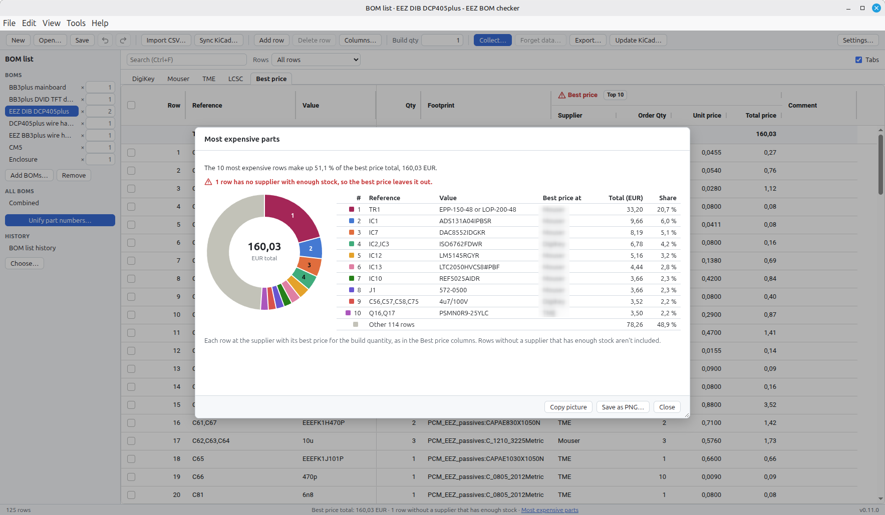
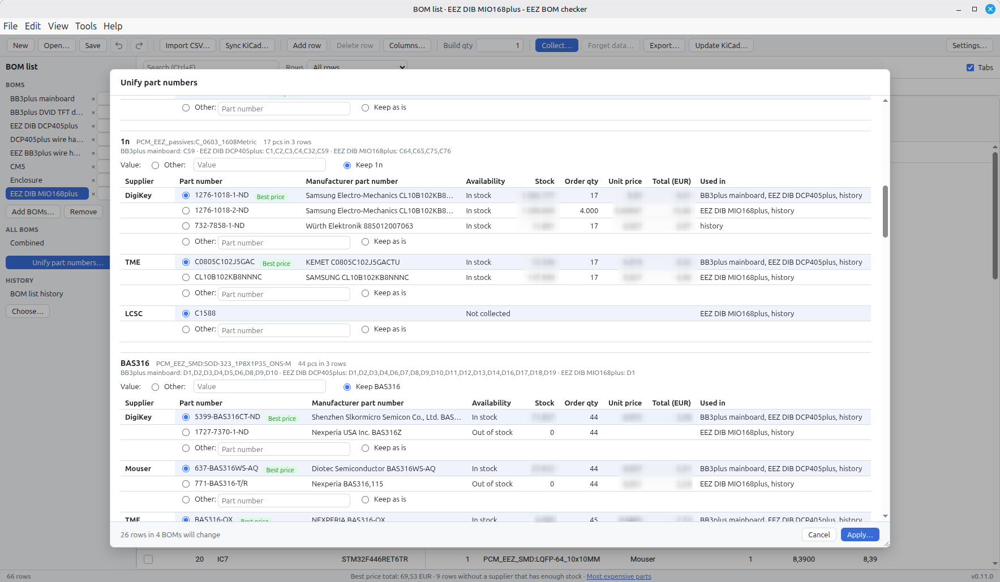

# EEZ BOM checker

 

 

A desktop app for Linux and Windows that checks a Bill of Materials (BOM) against DigiKey, Mouser, TME, and LCSC, while ensuring that the handling of the collected data complies with the suppliers' Terms of Service (TOS). It reports stock, prices, minimum order quantities (MOQ), lifecycle status and RoHS status, and picks the best-priced supplier for each part. The app was created to help maintain BOMs of multiple modules of a [BB3+](https://github.com/eez-open/eez-bb3plus) project.

## Features
* .csv import and direct import of a BOM from a [KiCad](https://www.kicad.org/) 10.x project
* Updating the KiCad, if imported BOM has been modified in the meantime
* Synchronizing an imported BOM if the KiCad project has been modified in meantime
* 1-click information collection of all selected suppliers that have an API
* "Best price" calculation
* Graphic representation of the 10 most expensive parts
* Adding custom suppliers and custom columns
* BOM lists for complex projects that have multiple BOMs with optimization by unifying part numbers
* Export to .xlsx, .ods, and .csv with a warning and password protected, ensuring that the suppliers' TOS is not violated
### Docs

- How to use it: [docs/user-guide.md](docs/user-guide.md)
- What the app must do: [BOM checker project scope.md](BOM%20checker%20project%20scope.md)
- How it is built: [BOM checker architecture.md](BOM%20checker%20architecture.md)

## Development

You need Node.js 24 (see `.nvmrc`) and Git.

```sh
npm ci          # install dependencies
npm run dev     # start the app with hot reload
```

| Command                | What it does                                                |
| ---------------------- | ----------------------------------------------------------- |
| `npm run dev`          | Start the app in development mode with hot reload           |
| `npm run build`        | Build into `out/`                                           |
| `npm run preview`      | Start the built app                                         |
| `npm run check`        | Type check, lint, format check and unit tests              |
| `npm test`             | Unit tests (Vitest)                                         |
| `npm run test:e2e`     | Start the built app and run the smoke test (Playwright)     |
| `npm run format`       | Format all files with Prettier                              |
| `npm run icon`         | Render `build/icon.svg` to the app icon PNGs in `build/`    |
| `npm run pack`         | Build an unpacked app into `release/` for a quick try       |
| `npm run dist:win`     | Build the Windows installer into `release/`                 |
| `npm run dist:linux`   | Build the AppImage and `.deb` into `release/` (Linux only)  |

Run `npm run build` before `npm run test:e2e`. To test a packaged app instead, set `E2E_APP_PATH` to its executable.

### Project layout

```
src/
  main/       Electron main process: windows, security, IPC handlers, logging
  preload/    Exposes the typed API (window.api) to the UI
  renderer/   React UI
  shared/     Types and pure logic used by both sides (data model, IPC contract)
e2e/          Playwright end-to-end tests
test-fixtures/ Test data, e.g. a real KiCad 10 project (gzipped)
build/        App icon (icon.svg is the source; electron-builder uses icon.png)
scripts/      Helper scripts
docs/         Developer documentation
```

BOM editing works on immutable `Project` objects: every operation in `src/shared/project-ops.ts` returns a new project. The UI store (`src/renderer/store/document.ts`) keeps the previous versions for undo, and compares with the last saved version to know whether there are unsaved changes.

The renderer has no Node.js access. Everything it needs from the main process goes through `window.api`, which is defined in `src/shared/ipc.ts`.

Dependencies used only by the UI (React, AG Grid) are `devDependencies`, because Vite bundles them into `out/renderer`. Only libraries that the main process loads at run time belong in `dependencies`; electron-builder copies those into the package.

### App data

Settings (`settings.json`), the encrypted supplier credentials (`vault.json`) and logs are stored in the app's data folder: `%APPDATA%\EEZ BOM checker` on Windows, `~/.config/EEZ BOM checker` on Linux. Set `EEZ_BOM_CHECKER_USER_DATA` to another folder to start with an empty profile; the end-to-end tests do this, so they never touch your own settings.

`EEZ_BOM_CHECKER_API_URLS` points the supplier integrations at other addresses, e.g. `{"mouser":"http://127.0.0.1:4567/mouser"}`. The end-to-end tests use it with the fake supplier server in `e2e/fake-suppliers.ts`, so they need neither network access nor real API keys.

The credential vault design is described in [BOM checker architecture.md](BOM%20checker%20architecture.md), section 7.2.

### Troubleshooting

If Electron prints `bad option: --remote-debugging-port` or starts as plain Node.js, the environment variable `ELECTRON_RUN_AS_NODE` is set. Processes started by VS Code extensions inherit it. Unset it, or run the command from a normal terminal.

## Testing and releases

GitHub Actions is disabled for this repository (since 0.10.0, to stay within the account's Actions storage), so tests and builds run locally. `.github/workflows/ci.yml` is kept for when it's enabled again.

Before merging a branch: `npm run check`, then `npm run build` and `npm run test:e2e`.

1. Update the version in `package.json` (and `package-lock.json`) and the `CHANGELOG.md`; merge.
2. Windows: `npm run dist:win`, then smoke-test the installer's app with `E2E_APP_PATH=release/win-unpacked/eez-bom-checker.exe npx playwright test`.
3. Linux, on a Linux machine: `npm ci`, `npm run dist:linux`, then `xvfb-run --auto-servernum npx playwright test` with `E2E_APP_PATH=release/linux-unpacked/eez-bom-checker`.
4. Tag the merge commit (`git tag v0.2.0`), push the tag, and create the release with the installers: `gh release create v0.2.0 --draft --title "EEZ BOM checker 0.2.0"`, then `gh release upload v0.2.0` with the files from `release/` on each machine (`*.exe`; `*.AppImage` and `*.deb`). Review the draft and publish it.

Upgrading Electron and other major dependencies: [docs/upgrade-checklist.md](docs/upgrade-checklist.md).

## License

[MIT](LICENSE)
